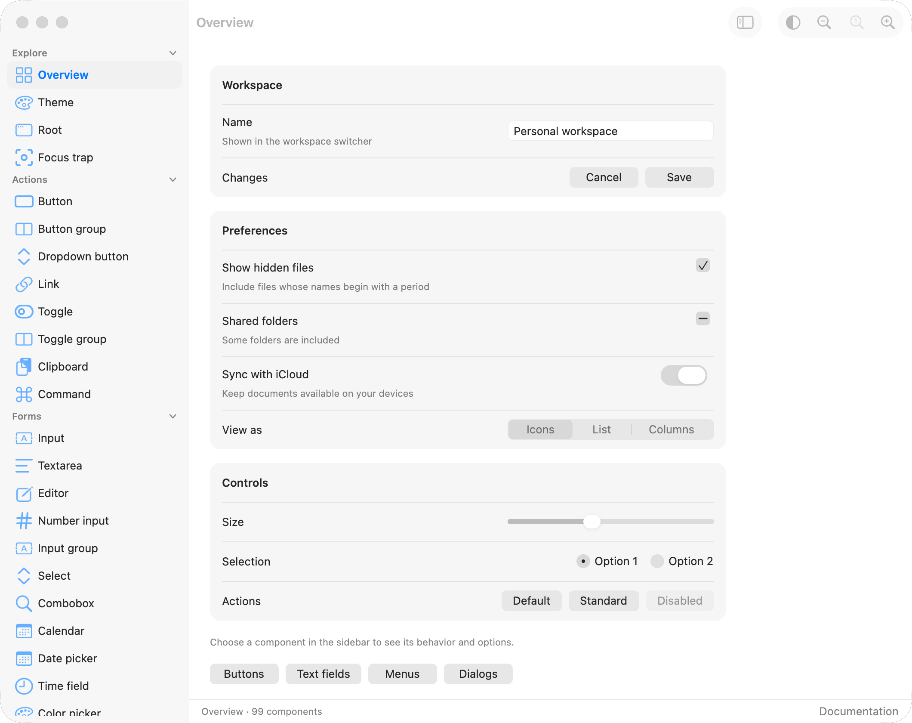
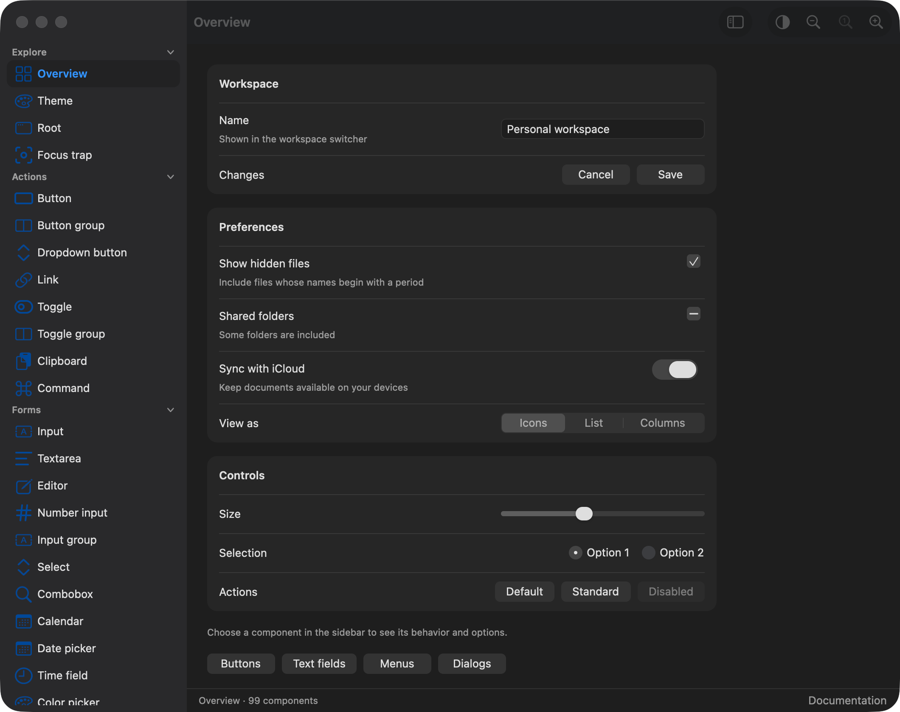

# gpui-macos

A macOS component library for **GPUI Kit 0.7.1**, with real AppKit toolbar
chrome, runtime SF Symbols, measured control geometry, and glass navigation surfaces.
The gallery contains **100 pages** covering the full GPUI Kit component catalog
and additional macOS layouts.




The design targets Apple's [macOS 27 design resources](https://developer.apple.com/design/resources/).
The library follows the approach demonstrated by
[gpui-omarchy](https://github.com/huacnlee/gpui-omarchy): custom presentation on
`gpui-base` behavior. Native adapters cover controls, overlays, navigation,
data views and seven chart types. Advanced components retain their complete
GPUI Kit APIs through `gpui_macos::kit` and share the same theme.

## Run

Install Rust through rustup and the Xcode command-line tools. The repository's
toolchain file selects the tested Rust version.

```sh
cargo run --example gallery
cargo run --example gallery -- button
cargo run --example gallery -- overview --light
cargo run --example gallery -- overview --dark
cargo run --example hello
```

On macOS, `scripts/bundle-gallery.sh` creates
`target/debug/GPUI macOS Gallery.app`, which you can launch from Finder.
Pass `release` to the script for a release build.

Use the sidebar to explore every component. The native appearance button cycles
System, Dark and Light; the fallback Appearance menu lists each mode. Tab navigates controls; arrow keys navigate option
groups and the sidebar. The toolbar's zoom controls range from 50% to 200%.

## Compare with real AppKit

The Swift reference uses real `NSButton`, `NSSwitch`, `NSTextField`,
`NSSegmentedControl`, `NSPopUpButton`, `NSSlider` and `NSTableView` controls.
The matching GPUI example uses this library's public constructors.

```sh
scripts/build-native-reference.sh
scripts/bundle-native-compare.sh
cargo run --example native_compare -- --light
cargo run --example native_compare -- --dark
```

Launch `target/native-reference/Native macOS Reference.app` and
`target/debug/GPUI Native Compare.app` from Finder. Both accept `--light`,
`--dark`, and `--page controls|workspace`. The Swift reference also supports
`--page sidebar` for the native navigation comparison, and
`--measure --metrics <path>` without opening a window. Checked-in
[native measurements](docs/native-metrics.json) record macOS 26.2 intrinsic
dimensions and light/dark semantic colors. See the
[interactive comparison](docs/comparison.html) for side-by-side and overlay
views, with [comparison notes](docs/comparison.md) describing remaining differences.

## Add to an application

Add the published crate:

```toml
[dependencies]
gpui-macos = "0.1.1"
```

For development from a checkout, use `gpui-macos = { path = "../gpui-macos" }`.

The crate reexports its matching `gpui-kit` dependency, avoiding duplicate
framework versions. The five pinned Kit crates are included under `vendor/`,
with portable local dependencies and small Base extensions for secure masks
and popup factories; consumer patch tables are unnecessary. See
[source provenance](vendor/README.md). This complete example uses native window controls and a
Root host for overlays, focus, notifications and text selection:

```rust,no_run
use gpui_macos::{gpui_kit::*, *};

struct Hello { clicks: usize }

impl Render for Hello {
    fn render(&mut self, _: &mut Window, cx: &mut Context<Self>) -> impl IntoElement {
        focus_scope("hello")
            .size_full()
            .flex().flex_col()
            .child(title_bar("My Mac App", cx))
            .child(div().flex_1().p_6().bg(cx.macos().background).child(
                panel("Welcome", cx).child(
                    button("hello", format!("Clicked {} times", self.clicks),
                           ButtonVariant::Primary, cx)
                        .on_click(cx.listener(|this, _, _, cx| {
                            this.clicks += 1;
                            cx.notify();
                        })),
                ),
            ))
    }
}

fn main() {
    application().with_assets(NativeAssets::new(gpui_kit::assets::AllAssets)).run(|cx| {
        gpui_macos::init(cx);
        gpui_macos::open_window(gpui_macos::window_options("My Mac App", cx), cx,
            |_, cx| cx.new(|_| Hello { clicks: 0 }))
            .expect("open window");
        cx.activate(true);
    });
}
```

See [examples/hello.rs](examples/hello.rs) and the
[complete gallery](examples/gallery/app.rs) for runnable applications.

## Components and state

The [component index](docs/components.md) lists every preview, public API and
upstream reference. `catalog::COMPONENTS` supplies typed metadata and
`catalog::COMPONENT_GROUPS` supplies the same ordered groups used by the gallery.

Applications own checkbox, switch, radio, toggle and selection state. Pass the
current value on each render, then update it in `on_change` or `on_click`.
Checkbox, Radio and Switch also expose `child_with_state` for children that
need the final disabled flag; `child_with_disabled` remains a bool adapter.
`ControlState::focus_visible` is reserved and currently false.

Editors, pickers, trees and virtual lists retain their `Entity` state. IDs must
be stable and unique among siblings. Wrap a window's controls in `focus_scope`
for Tab traversal. Use `open_window` to install a Root host and appearance
observation; applications using their own window host can call `observe_window`
once and construct `gpui_kit::base::Root` themselves.

Use the native convenience constructors at the crate root. The complete
advanced API is available under `kit`, for example `kit::input::Input` for a
code editor, `kit::table::DataTable` for sortable virtual data tables,
`kit::diff::Diff`, `kit::command::Command`, and `kit::questionnaire::Questionnaire`.
Advanced component modules such as `form`, `rating`, `carousel`, `message`,
`spinner` and `notification` are also reexported directly.

## Appearance

`init(cx)` follows the system. An explicit theme applies to every window and
the native window chrome:

```rust,ignore
Theme::light().apply(cx);
Theme::dark().with_accent(gpui_kit::rgb(0xaf52de).into())
    .with_glass_tint(0.8).apply(cx);
Theme::follow_system(cx);
```

The accent and material tint survive system appearance changes. The theme
updates native adapters, GPUI Base semantic tokens and GPUI Kit resolved tokens
together. `Theme` exposes color, font and material values for custom controls.
Use `NativeTextStyle::native_text_style(TextStyle::Body, cx.macos())` for custom
text. The native roles set family, size, weight and absolute line advance:
Body is 13/16 points, Title3 is 15/20. Points are applied in rems so text scales
with zoom. Values in `src/tokens.rs` cite `docs/native-spec.md`.

Base uses native type and radius scales. Kit theme updates are repaired before
the next ordinary frame; scrollbar and resize settings stay under Kit's control.
Raw `kit::*` components retain Kit's text sizing.
Dimensions use rem units so interface zoom also scales control geometry.
Call `set_zoom(125, window, cx)` to set a window to 125%; `zoom_percent(window)`
reads it back. The Root host preserves this setting across renders and theme
changes, with a supported range of 50% to 200%.

On macOS, system appearance reads Reduce transparency and Increase contrast.
GPUI Base reads Reduce motion during initialization. Call
`refresh_accessibility(cx)` after a runtime Display preference change to read
these settings again. Applications can also apply explicit accessibility
preferences with the theme builders or `cx.set_reduce_motion(true)`.

## Rendering and platform scope

These are **GPUI-rendered controls**, with native macOS visual conventions and
shared keyboard, input, IME, clipboard and accessibility behavior. They are
built on GPUI Kit interaction primitives. On macOS, the gallery and comparison
app install an actual unified AppKit toolbar and native search. AppKit supplies
its window corners and command glass. Sidebars use genuine `NSGlassEffectView`
underlays on macOS 26 and newer. `native_material(id, role, cx)` and
`native_toolbar_group(id, cx)` expose the same glass for application layouts.

Keep roots transparent and paint opaque backgrounds in content panes. Navigation
underlays sample behind the window. Anchored popovers, menus, choice lists,
date/color pickers and hover cards use retained content factories in separate
GPUI popup windows inside real `NSGlassEffectView` surfaces. These can sample
the GPUI canvas beneath them. Custom overlays can use
`native::open_glass_panel`; build retained `Render` entities rather than passing
frame-local elements between windows. Existing one-shot Base content builders
retain inline presentation. Headless windows, older systems and Reduce
Transparency use opaque fallbacks with the same interactions. Run
`scripts/bundle-glass-compare.sh` for an interactive canvas comparison.
Use `native_window_options` when installing native chrome. See
[`native`](src/native.rs) for the toolbar's retained handle and native inset.

System fonts are resolved on the host; Apple fonts and SF Symbols are not
bundled. Use `NativeAssets::new(gpui_kit::assets::AllAssets)` to supply runtime
SF artwork to nested Kit icons as well as the macOS adapters. Unavailable
symbols and custom assets delegate to the supplied source. The complete Lucide
catalog remains available as fallback.
The native gallery is validated on
macOS 26.2, with macOS 27's documented design as the target. Windows and Linux
can render the design but have different window decoration and blur support.

Optional features:

| Feature | Purpose |
| --- | --- |
| `gpui-fast` (default) | GPUI Fast renderer, matching the reference library |
| `tree-sitter` | Editor syntax-highlighting infrastructure |
| `tree-sitter-languages` | The upstream language bundle |
| `speech` | System speech input; uses the host's microphone/recognizer permissions |

The Speech gallery page explains the disabled feature and its supported
platform path without requesting microphone access automatically.

## Validation

```sh
cargo fmt --check
cargo check --all-targets --locked
cargo test --all-targets --locked
cargo test --doc --locked
cargo clippy --all-targets --locked -- -D warnings
```

Tests exercise pointer and keyboard activation, disabled state, focus traversal,
editor affixes, grouped selections, dialogs, pickers, menus, animation and
reduced motion. The gallery render sweep visits every catalog page in both
appearances. CI runs on macOS. See [design notes](docs/design.md) for boundaries.

## License and credits

The implementation is [MIT](LICENSE). The distributed package also includes
an Apache-2.0 upstream source fixture, so its package metadata is
`MIT AND Apache-2.0`. Behavioral adapters, the initial gallery, charts and the
plot tooltip derive from Jason Lee's MIT-licensed gpui-omarchy. See [NOTICE](NOTICE)
and the [license/source records](licenses/README.md). GPUI Kit and GPUI retain
their Apache-2.0 licenses. Application bundles include dependency notices and
MPL source archives. Apple is not affiliated with this library.

The root package remains `gpui-macos`; the five patched Kit packages use
`gpui-macos-*` names with exact matching versions. See the
[publishing instructions](docs/publishing.md) for offline archive verification
and dependency-ordered release commands.
