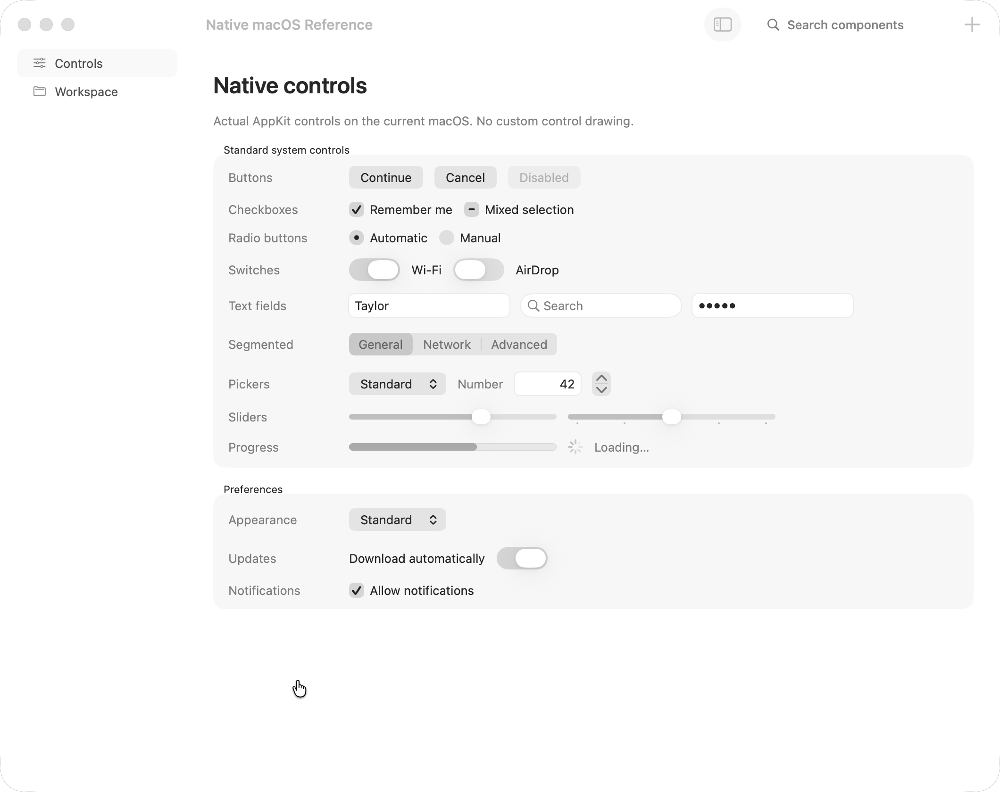
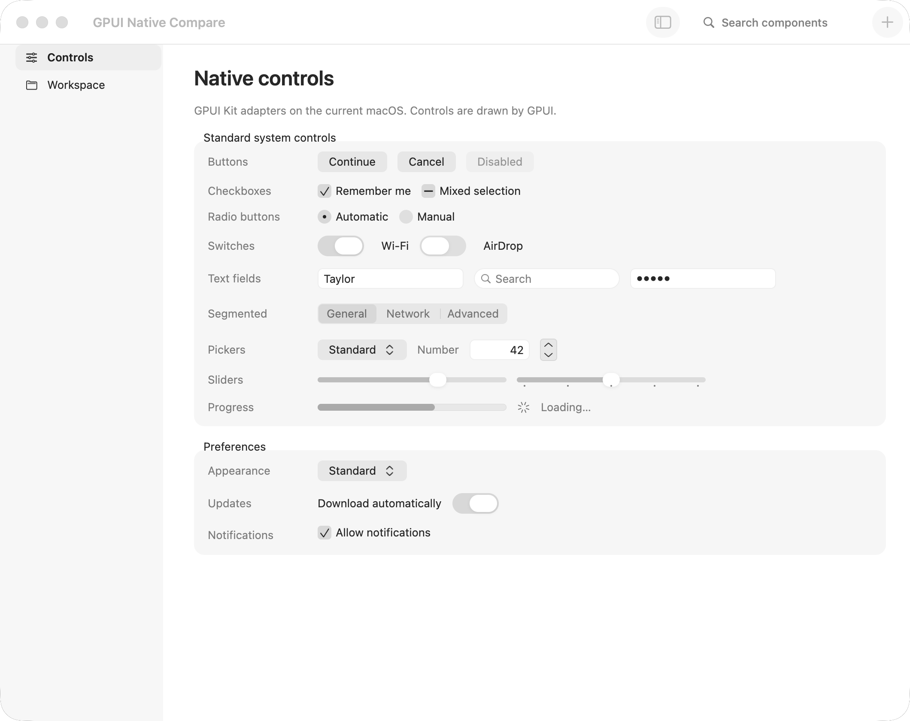
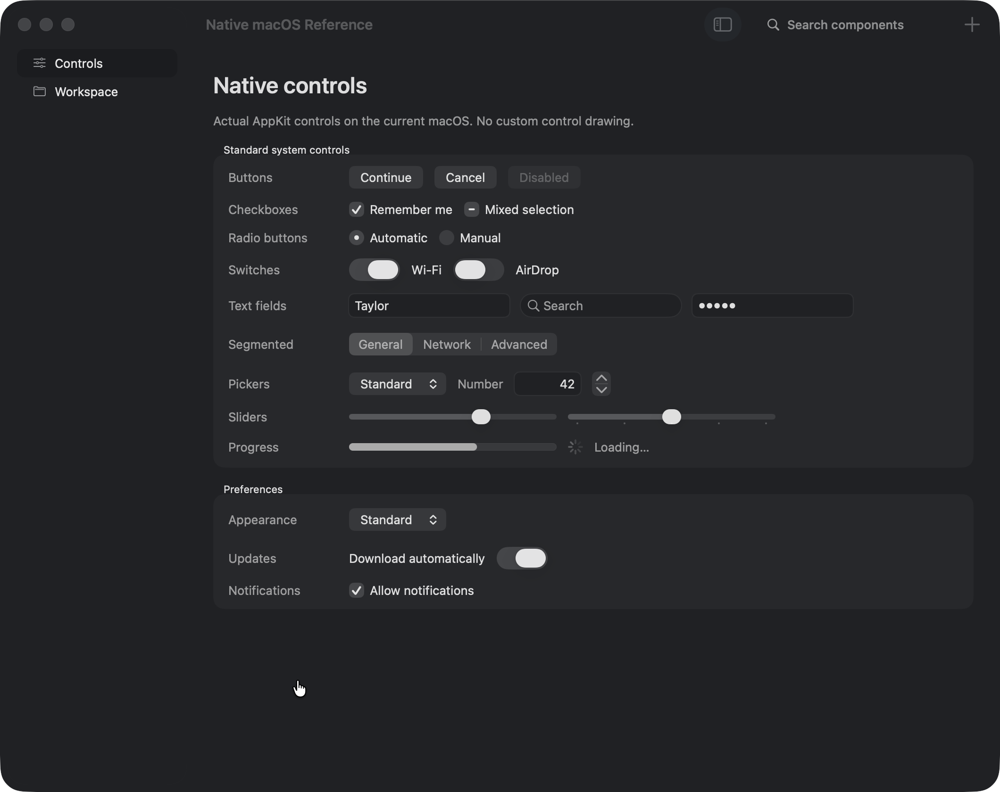
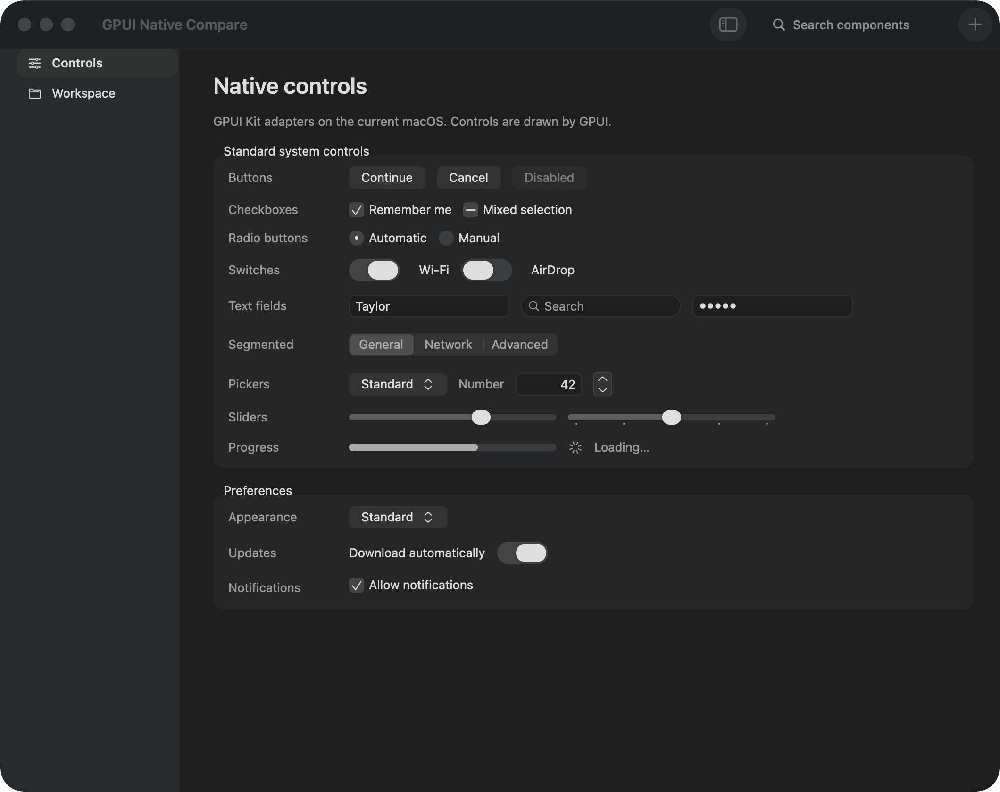
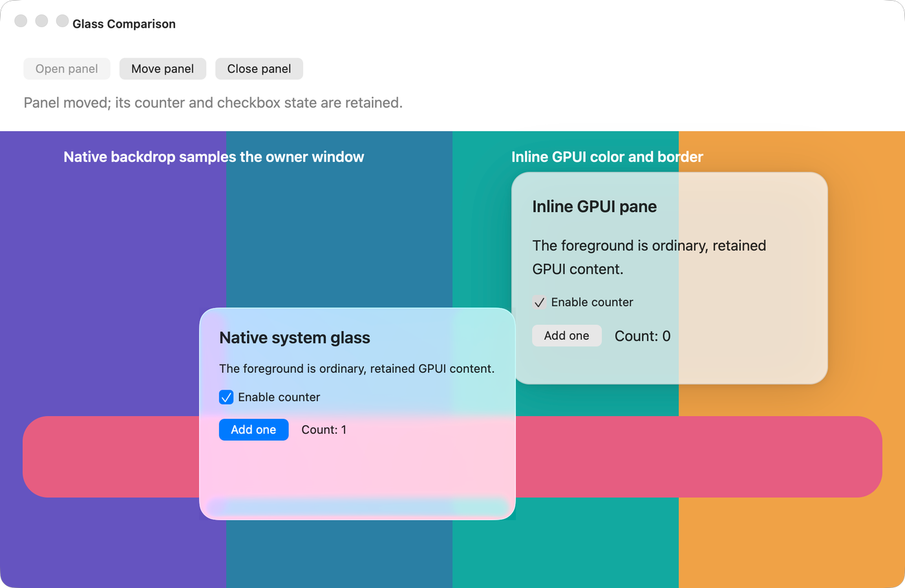

# AppKit and GPUI comparison

The native reference is written in Swift and draws ordinary system AppKit
controls. The GPUI specimen uses the same labels, rows and retained values,
through this library's public adapters. Both captures use a 1060 × 840 point
window at 2× scale on macOS 26.2. Desktop captures use RiWork's Cua.ai Driver.

Open the [interactive comparison](comparison.html) for light/dark selection,
side-by-side views, and an opacity overlay.

| Real AppKit — light | GPUI — light |
| --- | --- |
|  |  |

| Real AppKit — dark | GPUI — dark |
| --- | --- |
|  |  |

## Measurements applied

The reference exports [actual native metrics](native-metrics.json) without a
window. Regular buttons, editors, segmented controls, pop-up buttons and
switches report 24 point intrinsic heights. Switches report 54 point widths.
The captured native switch thumb is an elongated pill, and the slider thumb
is a smaller horizontal pill. Text fields have a white/dark content well;
buttons and segments use a neutral gray bezel. Preference groups are quiet
gray regions on plain content. Labels use the system font at 13 points.

Text uses the native line height. The 13 point system font measures 16
point lines in both `NSTextField` and `NSLayoutManager` (ascender 12.57,
descender 2.74, no leading) on macOS 27; GPUI's default was 1.618 × size,
or 21 points. Window roots now inherit `16/13` × font size, so it scales
with zoom, and the base type tokens use the measured label heights (10→13,
11→14, 13→16, 15→19, 20→24 points). The button page's rows now land within
a point of the SwiftUI reference; previously they drifted down by up to 17 points.

Disabled colors come from AppKit controls rendered offscreen with
`cacheDisplay` (active state) in light and dark. Tinted push buttons
(`bezelColor`, SwiftUI `.borderedProminent`) keep their accent or red bezel
at 69% opacity when disabled. AppKit draws the label white at about 12.5%
over it; SwiftUI draws it at 50%, and the library follows SwiftUI so the
label stays legible. A disabled on switch keeps a 70% accent
track and an opaque thumb. A disabled checked checkbox or radio is a neutral
well (7.5% primary ink; 5% when empty) with a 31% gray mark, not a faded
accent. Disabled labels use `disabledControlTextColor` (63/255). An AppKit
default button (`keyEquivalent = "\r"`) does turn gray when disabled. The
`selectOne` segmented control on macOS 27 fills the selected segment with
accent (about 75% when disabled). The adapter keeps its neutral selected
segment.

These findings replace the initial 28 point controls, circular switch thumbs,
elevated cards and oversized overview. The gallery now opens to ordinary
editable preferences and the selected component has a compact toolbar title.

The Sidebar specimen in the interactive comparison uses a real Swift
`NSOutlineView` with `.sourceList`, default system row sizing, and standard
`NSTableCellView` text/image outlets. Its measured regular rows are 32 points,
group headers 19 points, item labels 13 points, and group labels 11 points.
The text starts 28 points into the native cell after a 24 point icon column.
Later groups have 13 points of leading space. These measurements are included
in [native metrics](native-metrics.json).
The small/medium/large preferences measure 24/32/40 point rows,
11/13/15 point labels, and 20/24/26 point icon columns; the adapter follows
these settings together.

The gallery sidebar spans the window height, including behind the native
toolbar. Only the detail column reserves the toolbar inset and draws the
status bar. A public AppKit titlebar accessory places the real window title
after the sidebar; hiding navigation removes that accessory. Each component
has a purpose-specific icon, and category disclosure buttons preserve the
selected page when collapsed. Keyboard navigation reveals a selected page's
group. The library reads the system source-list row height through a cached
AppKit view; `refresh_accessibility` refreshes it after settings changes.

The installed AppKit source list uses vibrant selection paint. Its visible
inactive fill differs from the opaque `unemphasizedSelectedContentBackgroundColor`.
The material treatment is measured from the actual light/dark captures;
reduced transparency and increased contrast retain opaque semantic selection.
The edge treatment and semibold selected label follow Apple's
[macOS 27 AppKit guidance](https://developer.apple.com/videos/play/wwdc2026/289/).
Native glass responds to its background, so these captures establish a host
baseline rather than pixel equality on every desktop.

The debug application bundle also embeds fallback SVGs. A fresh launch
previously stalled in a filesystem read from the source checkout before its
window appeared. The assets fork enables `rust-embed`'s
[`debug-embed` feature](https://pyrossh.dev/repos/rust-embed), so both debug
and release applications load bundled bytes. A regression check verifies the
fallback returns embedded bytes, and a fresh Cua launch renders the corrected
dark sidebar successfully.

Secure editors now match the measured AppKit mask size and spacing. An actual
offscreen `NSSecureTextField` cell draws 5.5 point circular ink with an 8 point
advance. The adapter uses a filled circle (`●`) in Helvetica Neue at 12.8
points, whose CoreText ink is 5.4528 points with the same 8 point advance.
Only nonempty masked editor text uses this font; placeholders, affixes and
revealed text retain the ordinary system font. The [secure-field measurements](native-secure-metrics.json)
and [headless measurement helper](../tools/native-reference/measure-secure-mask.swift)
record this macOS 26.2 baseline. The library targets macOS 27; these numbers
are measurements of the installed 26.2 system, not a 27 raster capture.
Rendered tests verify Unicode selection and IME replacement, blocked password
copy/cut, and hidden accessibility values.

## Scope of the comparison

Both captures are background windows. The GPUI adapters now read the actual
window activation state and suppress accent paint just as the native reference
does. Active and inactive paint, disabled behavior, and reactivation are also
verified in rendered tests. The Swift checkbox was toggled through Cua's
accessibility action and its checked value was read back. The native GPUI
toolbar's Add and sidebar actions were verified against their visible results.
Typing into the native toolbar search changed its accessibility value and
updated the GPUI caption to `Search: g`. GPUI pauses its display link while a
window is fully occluded, so a window resize was used to verify that state in
the background capture. Command-Q also closes the example while native search
owns keyboard focus.

The host and SDK are macOS 26.2. Latest macOS 27 refinements come from Apple's
[public UI Kit preview](https://developer.apple.com/design/resources/)
and [AppKit guidance](https://developer.apple.com/videos/play/wwdc2026/289/),
including edge-to-edge sidebars and semibold selected labels. The complete
Figma/Sketch kit has not been downloaded.

The GPUI app now installs a real unified `NSToolbar`, including native
`NSSearchField` and SF Symbol commands. AppKit supplies its toolbar grouping and
window corners. Sidebars host `NSGlassEffectView`; explicit `native_material`
and `native_toolbar_group` builders expose the same material to applications.
The asset source also substitutes host-supplied SF artwork inside upstream Kit
components: 103 of the 106 default icons and 419 of the 1,830 full-catalog names
resolve on this host. Unsupported names retain their bundled fallback. The
activity indicator uses the host's `progress.indicator` artwork.

Controls still use GPUI's renderer and interaction primitives. Their paint is
measured and activation-aware, rather than AppKit control instances. The
specimen's stepper and tick marks remain compositions. Secure editors use the
measured native mask geometry while retaining GPUI Base's editing behavior.

Canvas refraction is now handled with separate GPUI popup windows. AppKit's
`NSGlassEffectView.contentView` contains the popup's original content view,
preserving the GPUI renderer, AccessKit adapter, input handling and window
delegate. The owner canvas sits below that popup at the WindowServer level,
so the real glass can sample it. Retained content factories build fresh
elements in the presenting window; no frame-local elements cross windows.

The [glass comparison](../examples/glass_compare.rs) was exercised through Cua:
the native pane's accessible button changed Count from 0 to 1, its checkbox
toggled and disabled the command, and moving the pane retained both values.
The pink shape's edge blurs through the material in this fresh capture.

Anchored macOS adapters use this native popup presentation where available.
One-shot Base content builders retain inline rendering; custom canvas overlays
can use `native::open_glass_panel` with retained `Render` entities. Unsupported
hosts and reduced transparency keep the same content in opaque fallback
surfaces. The source uses public AppKit APIs without changing GPUI's renderer.

The gallery's [popover capture](images/gallery-native-popover-light.png) records
both accessible controls switched off: hidden files disappear from the workspace,
and its sync status changes to paused. The [submenu capture](images/gallery-native-submenu-light.png)
shows the child glass window beyond its parent's right edge. Selecting
`Export as PDF` updates the owning gallery and dismisses both menu windows.
Pointer, keyboard, Escape, disabled-trigger and focus-return regression tests
cover the same presentation adapters.

The [Setup Assistant interpretation](images/gallery-setup-assistant-light.png)
uses 13-point option labels and 24-point Back, Continue and Done commands.
Live accessibility actions advanced to the second question, selected Compact,
and submitted two retained preferences. The [document preview interpretation](images/gallery-document-preview-light.png)
keeps its illustration inside a bounded image well and its filename and metadata
below it. Its Next command selected the itinerary and enabled Previous.
Rendered checks cover all three slides and thumbnails, validation, navigation,
Skip, and submission through the original Kit state.

The final all-target run passes 165 tests, including 600 gallery draws. A
documentation example compiles, and Clippy passes with the optional speech and
Tree-sitter grammar features enabled and warnings denied. The disabled-button
node test verifies AccessKit's disabled flag, name and role, and the absence of
activation and focus actions. Popup regression tests preserve later owner focus
or intentional blur, and keep open state when Reduce Transparency switches the
presentation between native glass and an opaque inline surface.
